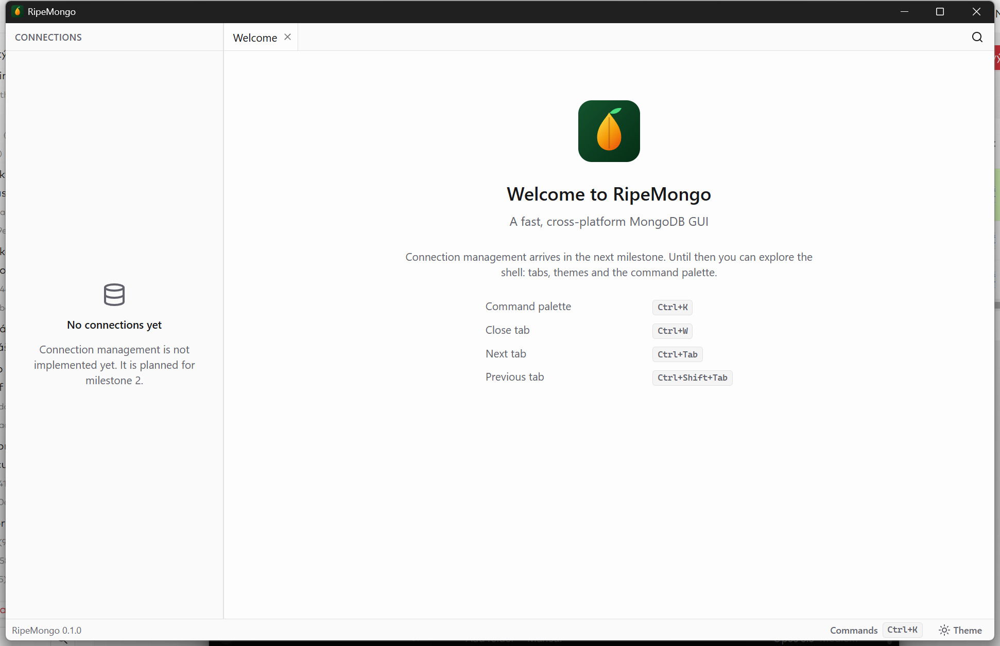

# RipeMongo

A fast, cross-platform desktop GUI for MongoDB. It aims to fully replace MongoDB Compass, and it
ships the official database tools (dump, restore, import, export) inside the app, so you never
need the command line.

> **Status: early development (milestone 1 of 8).** The app shell runs, but connecting to
> MongoDB is not implemented yet. See the [CHANGELOG](CHANGELOG.md) for what works today.



## Planned highlights

- Connection manager with keychain-stored secrets, TLS and SSH tunnels
- Document browsing in list, JSON and table views, with full BSON / Extended JSON support
- Visual aggregation pipeline builder with per-stage previews
- Schema analysis, explain plans, index and validation management
- Server performance dashboard
- Built-in dump / restore / import / export / copy between servers with progress, cancel and
  saved profiles
- Light, dark and system themes, a command palette, and keyboard shortcuts everywhere

## Download

Installers for Windows, macOS and Linux will be published on the releases page once the first
usable milestone ships.

## Build from source

Prerequisites: Node.js ≥ 22.12, pnpm 9, Rust (stable) and the
[Tauri prerequisites](https://tauri.app/start/prerequisites/) for your OS.

```sh
pnpm install
pnpm app:dev      # run in development mode
pnpm app:build    # build installers for the current platform
```

See [docs/getting-started.md](docs/getting-started.md) for the full setup per OS.

## Documentation

The [user guide](docs/user-guide/README.md) explains how to use the app. Everything else lives in [docs/](docs/README.md): architecture, features, development guides and
decision records.
