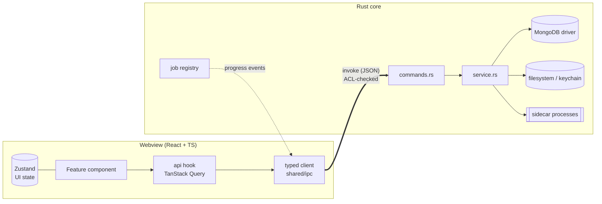

# Architecture overview

RipeMongo is a Tauri 2 application: a Rust process that owns all I/O (MongoDB, filesystem,
keychain, child processes) and a React frontend rendered in the OS webview.

## Layers

| Layer            | Location                        | Responsibility                                        |
| ---------------- | ------------------------------- | ----------------------------------------------------- |
| UI components    | `src/features/*/components`     | Rendering, user interaction, accessibility            |
| UI state         | `src/features/*/store`          | Ephemeral UI state (Zustand): tabs, open dialogs      |
| Server state     | `src/features/*/api`            | TanStack Query hooks; caching, loading/error states   |
| Typed IPC client | `src/shared/ipc`                | Generated bindings + error normalization (`IpcError`) |
| Tauri boundary   | `src-tauri/src/*/commands.rs`   | Thin: extract state, call service, convert error      |
| Services         | `src-tauri/src/*/service.rs`    | Business logic; unit-testable without Tauri           |
| Infrastructure   | drivers, fs, keychain, sidecars | External systems                                      |

## Request flow (example: load settings)

1. `App` calls `useSettings()` (`src/features/settings/api/settings.ts`).
2. The query function runs `unwrap(commands.getSettings())`.
3. `commands.getSettings` (generated) invokes `get_settings`; Tauri checks the
   `allow-get-settings` permission from `capabilities/default.json`.
4. `settings::commands::get_settings` gets the managed `SettingsStore` and calls `load()`.
5. On failure `SettingsError` converts into `AppError { code, message, hint }`.
6. The client turns an error result into a thrown `IpcError`; TanStack Query exposes it as
   `error`, and the UI renders `ErrorState` (queries) or a toast (mutations).

## Startup sequence

`main.rs` → `lib::run()` → init tracing → build the specta registry → (debug) export
bindings → `tauri::Builder` with the invoke handler → `setup`: mount events, register
`SettingsStore` → open the `main` window. The frontend waits for settings before the first
paint so the saved theme is applied immediately.

## Cross-cutting decisions

See the [ADRs](../adr/README.md), especially 0002 (Rust owns all DB access), 0003 (generated
types) and 0006 (error model).
