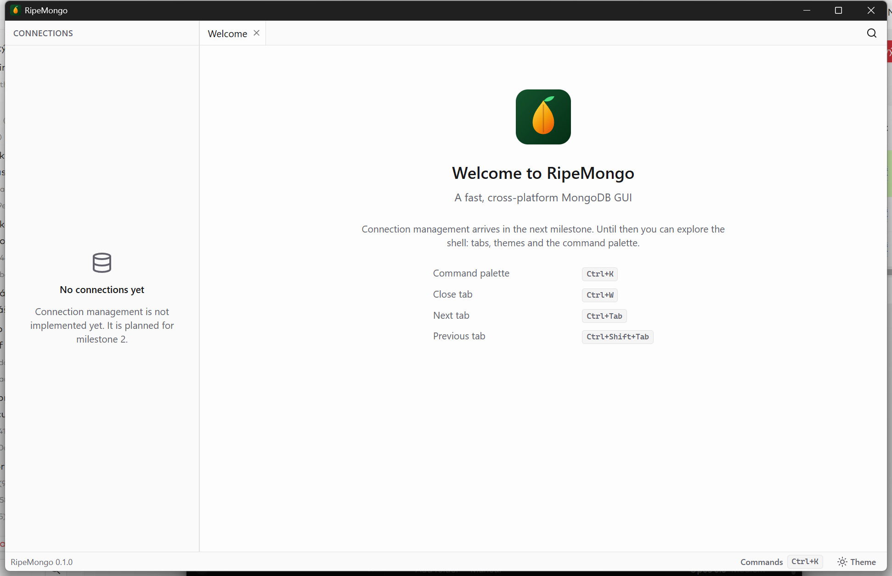

# The interface

## Sidebar

The left side lists your saved connections. Favorites come first, then folders, then the rest.
The dot next to each connection shows its state:

| Dot      | Meaning                            |
| -------- | ---------------------------------- |
| Hollow   | Not connected                      |
| Spinning | Connecting                         |
| Green    | Connected                          |
| Red      | The last attempt to connect failed |

Click the arrow next to a connected connection to see its databases and collections; see
[Databases and collections](databases-and-collections.md).

Drag the border between the sidebar and the main area to resize it.

## Tabs

Everything you open appears as a tab: the Welcome tab, connection overviews and collections
(later also queries). Open the same item twice and RipeMongo switches to the existing tab.

- Close a tab with its **×** button or **Ctrl+W** (**⌘W** on macOS).
- Move between tabs with **Ctrl+Tab** and **Ctrl+Shift+Tab**, or with the arrow keys when the
  tab bar has focus.

## Command palette

Press **Ctrl+K** (**⌘K** on macOS), or click the magnifier at the top right, to open the command
palette. Type a few letters to find any action, such as "new connection", "theme dark" or
"connect to production", then press **Enter**.

## Theme

Choose **System**, **Light** or **Dark** from **Theme** in the bottom-right corner, or from the
command palette. With **System**, RipeMongo follows your operating system and switches
automatically.

## Status bar

The bottom bar shows the RipeMongo version, a shortcut to the command palette and the theme
switch. **About RipeMongo** in the command palette shows the version and platform, which is
useful when reporting a problem.
